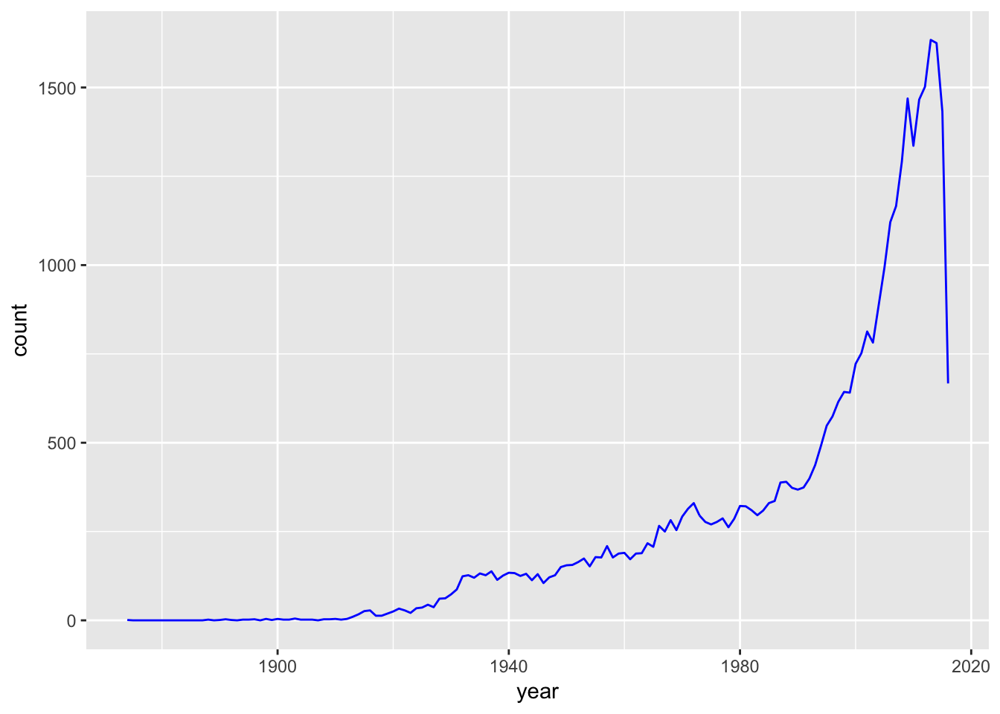
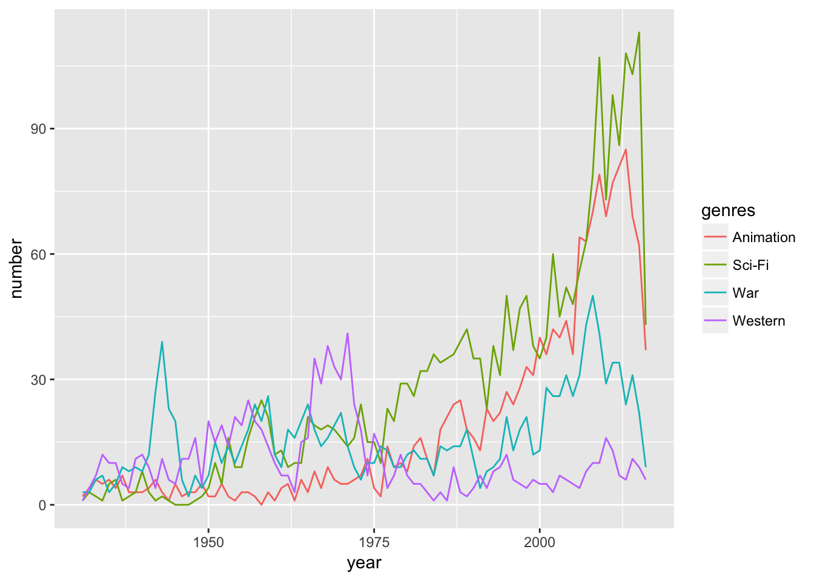
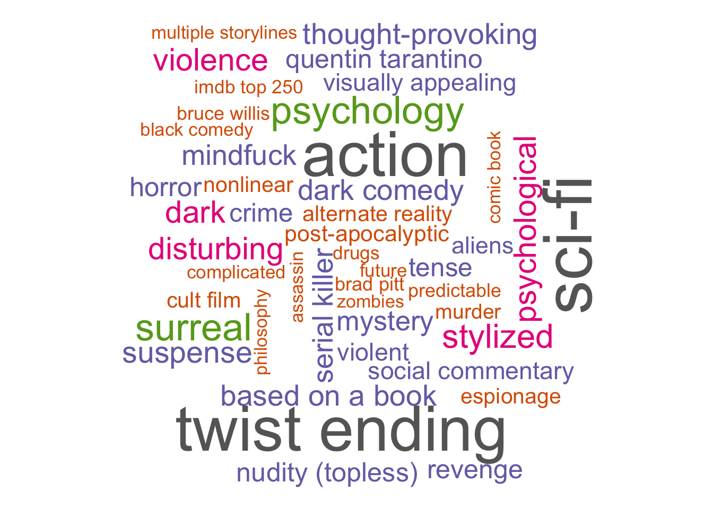
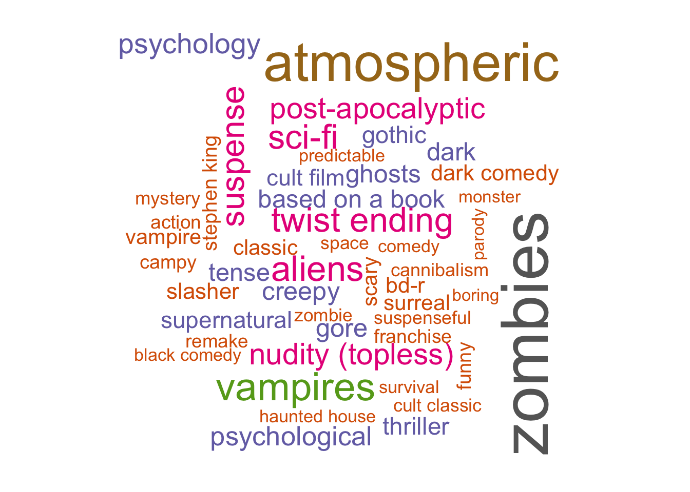
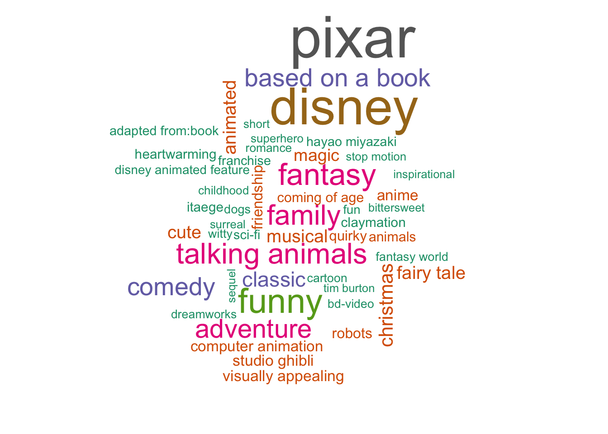
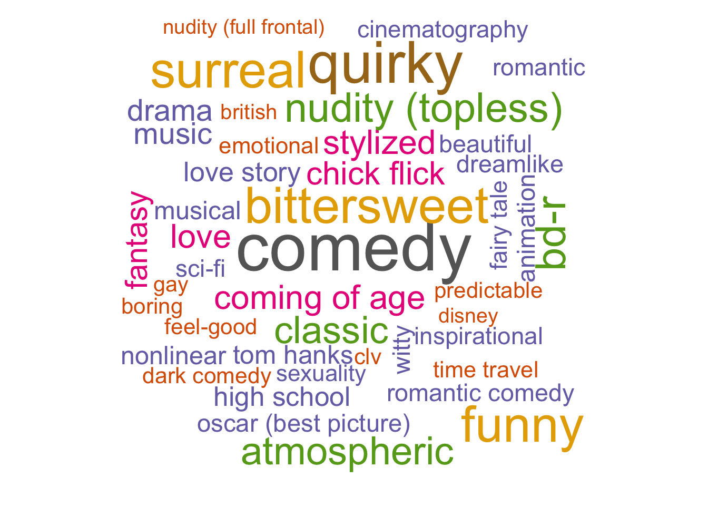
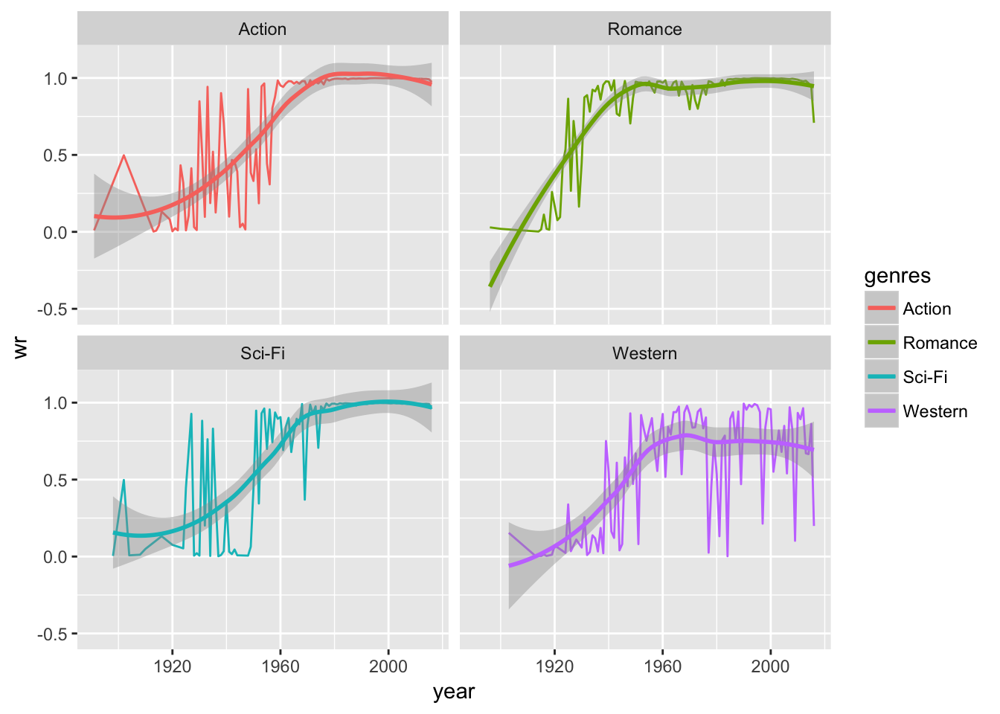
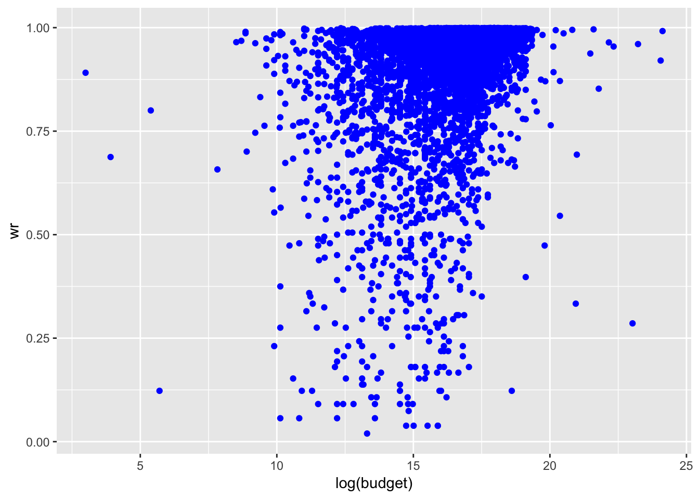
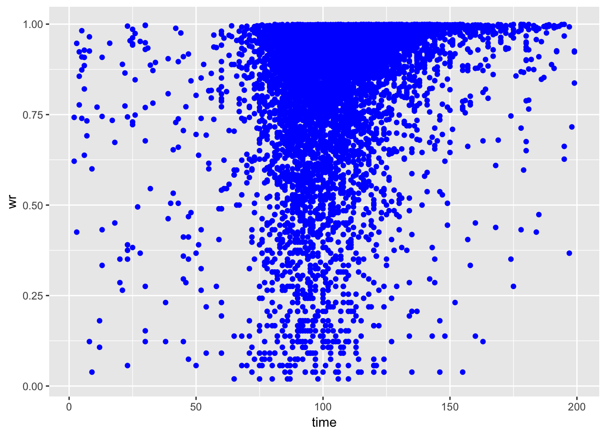

+++
title = "movieLens dataset analysis"
description = "An exploratory analysis of the movieLens dataset in R: movies per year, genre popularity, tags per genre and the best-rated films of each decade."
date = 2017-02-03
# Keeps the address this post had on the old site working.
aliases = ["/2017/02/03/movielens/"]

[taxonomies]
tags = ["r", "data-science"]
+++

## Introduction

> The sources are available [here](https://github.com/redroy44/movieLens_analysis).

This is a report on the movieLens dataset available [here](https://grouplens.org/datasets/movielens/). MovieLens itself is a research site run by GroupLens Research group at the University of Minnesota. The first automated recommender system was developed there in 1993.

<!-- more -->

### Objectives

The movieLens dataset is most often used for the purpose of recommender systems which aim to predict user movie ratings based on other users’ ratings. In other words we expect that users with similar taste will tend to rate movies with high correlation.

However, in this analysis we will try to explore the movies themselves. Hopefully it will give us an interesting insight into the history of cinematography.

### Packages used

For this analysis the Microsoft R Open distribution was used. The reason for this was its multithreaded performance as described [here](https://mran.microsoft.com/documents/rro/multithread/). Most of the packages that were used come from the [tidyverse](http://tidyverse.org/) - a collection of packages that share common philosophies of tidy data. The `tidytext` and `wordcloud` packages were used for some text processing. Finally, the `doMC` package was used to embrace the multithreading in some of the custom functions which will be described later.

> doMC package is not available on Windows. Use doParallel package instead.

```r
# Load the packages -------------------------------------------------------
library(checkpoint)
checkpoint("2017-01-15", auto.install.knitr=T)
library(tidyverse)
library(lubridate)
library(stringr)
library(rvest)
library(XML)
library(tidytext)
library(wordcloud)
library(doMC)
registerDoMC()
set.seed(1234)
```

The output of `sessionInfo()` is placed here for reproducibility purposes.

```r
# Print Session Information
sessionInfo()
```

    ## R version 3.3.2 (2016-10-31)
    ## Platform: x86_64-apple-darwin15.6.0 (64-bit)
    ## Running under: macOS Sierra 10.12.2
    ##
    ## locale:
    ## [1] pl_PL.UTF-8/pl_PL.UTF-8/pl_PL.UTF-8/C/pl_PL.UTF-8/pl_PL.UTF-8
    ##
    ## attached base packages:
    ## [1] parallel  stats     graphics  grDevices utils     datasets  methods  
    ## [8] base     
    ##
    ## other attached packages:
    ##  [1] doMC_1.3.4         iterators_1.0.8    foreach_1.4.3     
    ##  [4] wordcloud_2.5      RColorBrewer_1.1-2 tidytext_0.1.2    
    ##  [7] XML_3.98-1.5       rvest_0.3.2        xml2_1.0.0        
    ## [10] stringr_1.1.0      lubridate_1.6.0    dplyr_0.5.0       
    ## [13] purrr_0.2.2        readr_1.0.0        tidyr_0.6.0       
    ## [16] tibble_1.2         ggplot2_2.2.0      tidyverse_1.0.0   
    ## [19] checkpoint_0.3.18
    ##
    ## loaded via a namespace (and not attached):
    ##  [1] Rcpp_0.12.7       plyr_1.8.4        tokenizers_0.1.4
    ##  [4] tools_3.3.2       digest_0.6.10     evaluate_0.10    
    ##  [7] gtable_0.2.0      nlme_3.1-128      lattice_0.20-34  
    ## [10] Matrix_1.2-7.1    psych_1.6.9       DBI_0.5-1        
    ## [13] yaml_2.1.14       janeaustenr_0.1.4 httr_1.2.1       
    ## [16] knitr_1.15        RevoUtils_10.0.2  grid_3.3.2       
    ## [19] R6_2.2.0          foreign_0.8-67    rmarkdown_1.1    
    ## [22] reshape2_1.4.2    magrittr_1.5      codetools_0.2-15
    ## [25] scales_0.4.1      SnowballC_0.5.1   htmltools_0.3.5  
    ## [28] assertthat_0.1    mnormt_1.5-5      colorspace_1.3-0
    ## [31] stringi_1.1.2     lazyeval_0.2.0    munsell_0.4.3    
    ## [34] slam_0.1-38       broom_0.4.1

## Dataset Description

The dataset is avaliable in several snapshots. The ones that were used in this analysis were Latest Datasets - both full and small (for web scraping). They were last updated in October 2016.

### Dataset Download

First the data needs to be downloaded and unzipped. Although it is generally done only once during the analysis, it makes the reproducibility so much easier and less painful.

```r
url <- "http://files.grouplens.org/datasets/movielens/"
dataset_small <- "ml-latest-small"
dataset_full <- "ml-latest"
data_folder <- "data"
archive_type <- ".zip"

# Choose dataset version
dataset <- dataset_full
dataset_zip <- paste0(dataset, archive_type)

# Download the data and unzip it
if (!file.exists(file.path(data_folder, dataset_zip))) {
  download.file(paste0(url, dataset_zip), file.path(data_folder, dataset_zip))
}
unzip(file.path(data_folder, dataset_zip), exdir = data_folder, overwrite = F)

# Display the unzipped files
list.files('data/', recursive=T)
```

    ##  [1] "ml-latest-small.zip"         "ml-latest-small/links.csv"  
    ##  [3] "ml-latest-small/movies.csv"  "ml-latest-small/ratings.csv"
    ##  [5] "ml-latest-small/README.txt"  "ml-latest-small/tags.csv"   
    ##  [7] "ml-latest.zip"               "ml-latest/genome-scores.csv"
    ##  [9] "ml-latest/genome-tags.csv"   "ml-latest/links.csv"        
    ## [11] "ml-latest/movies.csv"        "ml-latest/ratings.csv"      
    ## [13] "ml-latest/README.txt"        "ml-latest/tags.csv"         
    ## [15] "placeholder"

### Loading the Dataset

The dataset is split into four files (genome-scores.csv and genome-tags.csv were omitted for this analysis)- movies.csv, ratings.csv, links.csv and tags.csv. We will iteratively load the files into the workspace using `read_csv()` function and assign variable names accordingly. The `read_csv()` function is very convenient because it automagically guesses column types based on the first 1000 rows. And more importantly it never converts strings to factors. Never.

Finally we will check object sizes to see how big is the dataset.

```r
dataset_files <- c("movies", "ratings", "links", "tags")
suffix <- ".csv"

for (f in dataset_files) {
  path <- file.path(data_folder, dataset, paste0(f, suffix))
  assign(f, read_csv(path))
  print(paste(f, "object size is", format(object.size(get(f)),units="Mb")))
}
```

    ## [1] "movies object size is 3.8 Mb"
    ## [1] "ratings object size is 465.5 Mb"
    ## [1] "links object size is 2.5 Mb"
    ## [1] "tags object size is 15.7 Mb"

The biggest data frame is ratings - 465.5 Mb - it contains movie ratings from movieLens users. Next we will see what kind of data we deal with.

## Data Cleaning

In this section we will take the first look at the loaded data frames. We will also perform necessary cleaning and some transformations so that the data better suits our needs. First, let’s look at the ratings table.

```r
# Clean ratings
glimpse(ratings)
```

    ## Observations: 24,404,096
    ## Variables: 4
    ## $ userId    <int> 1, 1, 1, 1, 1, 1, 1, 2, 2, 2, 2, 2, 2, 2, 2, 2, 2, 3...
    ## $ movieId   <int> 122, 172, 1221, 1441, 1609, 1961, 1972, 441, 494, 11...
    ## $ rating    <dbl> 2, 1, 5, 4, 3, 3, 1, 2, 2, 4, 3, 3, 4, 2, 2, 1, 3, 4...
    ## $ timestamp <int> 945544824, 945544871, 945544788, 945544871, 94554482...

We have 24 million rows and 4 columns. It seems that only timestamp column need to be converted. We will create new data frame that we will work on and preserve the original data frame (treat it as read-only).

```r
ratings_df <- ratings %>%
  mutate(timestamp = as_datetime(timestamp))

summary(ratings_df)
```

    ##      userId          movieId           rating     
    ##  Min.   :     1   Min.   :     1   Min.   :0.500  
    ##  1st Qu.: 63930   1st Qu.:  1015   1st Qu.:3.000  
    ##  Median :129401   Median :  2424   Median :3.500  
    ##  Mean   :129374   Mean   : 13535   Mean   :3.527  
    ##  3rd Qu.:194037   3rd Qu.:  5816   3rd Qu.:4.000  
    ##  Max.   :259137   Max.   :165201   Max.   :5.000  
    ##    timestamp                  
    ##  Min.   :1995-01-09 11:46:44  
    ##  1st Qu.:2001-01-02 06:27:59  
    ##  Median :2005-11-12 02:18:48  
    ##  Mean   :2006-06-10 18:32:38  
    ##  3rd Qu.:2011-06-08 23:54:44  
    ##  Max.   :2016-10-17 07:00:03

Ok, looks like there is no missing data. We can also see that the ratings range from 0.5 to 5 and that they are timestamped. Now, let’s look into the movies data frame.

```r
glimpse(movies)
```

    ## Observations: 40,110
    ## Variables: 3
    ## $ movieId <int> 1, 2, 3, 4, 5, 6, 7, 8, 9, 10, 11, 12, 13, 14, 15, 16,...
    ## $ title   <chr> "Toy Story (1995)", "Jumanji (1995)", "Grumpier Old Me...
    ## $ genres  <chr> "Adventure|Animation|Children|Comedy|Fantasy", "Advent...

There are over 40 thousand movies and 3 columns. Most of the movies have their debut year added to their names - we want to extract this into separate columns. Genres columns contains multiple categories per row - we want to have them separated into one category per row. We will deal with this later.

```r
movies_df <- movies %>%
  # trim whitespaces
  mutate(title = str_trim(title)) %>%
  # split title to title, year
  extract(title, c("title_tmp", "year"), regex = "^(.*) \\(([0-9 \\-]*)\\)$", remove = F) %>%
  # for series take debut date
  mutate(year = if_else(str_length(year) > 4, as.integer(str_split(year, "-", simplify = T)[1]), as.integer(year))) %>%
  # replace title NA's with original title
  mutate(title = if_else(is.na(title_tmp), title, title_tmp)) %>%
  # drop title_tmp column
  select(-title_tmp)  %>%
  # generic function to turn (no genres listed) to NA
  mutate(genres = if_else(genres == "(no genres listed)", `is.na<-`(genres), genres))
```

    ## Warning in replace_with(out, !condition & !is.na(condition), false,
    ## "`false`"): pojawiły się wartości NA na skutek przekształcenia

Here we extracted the movie debut year using `extract()` function from `tidyr` package. For the case of movie series where year has “yyyy-yyyy” format we take the first date. In the last line we replaced the string *“(no genres listed)”* with `NA` value to make further processing easier. There are also some warnings suggesting that missing values appeared. We’ll check that now.

```r
# Check NA's
na_movies <- movies_df %>%
  filter(is.na(title) | is.na(year))

knitr::kable(head(na_movies, 10))
```

| movieId | title                                                                | year | genres                          |
|--------:|:---------------------------------------------------------------------|-----:|:--------------------------------|
|    8359 | Skokie (1981)                                                        |   NA | Drama                           |
|   26815 | Deadly Advice(1994)                                                  |   NA | Comedy\|Drama                   |
|   40697 | Babylon 5                                                            |   NA | Sci-Fi                          |
|   79607 | Millions Game, The (Das Millionenspiel)                              |   NA | Action\|Drama\|Sci-Fi\|Thriller |
|   87442 | Bicycle, Spoon, Apple (Bicicleta, cullera, poma)                     |   NA | Documentary                     |
|   89932 | Me and the Colonel (1958)                                            |   NA | Comedy\|War                     |
|   89971 | On the Double (1961)                                                 |   NA | Comedy\|War                     |
|   89973 | Here Comes Peter Cottontail (1971)                                   |   NA | Animation\|Children\|Musical    |
|   90262 | Enchanted World of Danny Kaye: The Emperor’s New Clothes, The (1972) |   NA | Animation\|Children\|Musical    |
|   90453 | Mystics in Bali (Leák)(1981)                                         |   NA | Fantasy\|Horror\|Thriller       |

Seems that warnings appeared, because some of the movies do not have their debut year. We will ignore those movies in further analysis as there aren’t many of them.

```r
summary(movies_df)
```

    ##     movieId          title                year         genres         
    ##  Min.   :     1   Length:40110       Min.   :1874   Length:40110      
    ##  1st Qu.: 32972   Class :character   1st Qu.:1978   Class :character  
    ##  Median : 98457   Mode  :character   Median :2000   Mode  :character  
    ##  Mean   : 86841                      Mean   :1991                     
    ##  3rd Qu.:134560                      3rd Qu.:2010                     
    ##  Max.   :165201                      Max.   :2016                     
    ##                                      NA's   :141

Let’s check the tags data frame now.

```r
glimpse(tags)
```

    ## Observations: 668,953
    ## Variables: 4
    ## $ userId    <int> 28, 40, 40, 57, 73, 98, 98, 98, 98, 98, 98, 98, 141,...
    ## $ movieId   <int> 63062, 4973, 117533, 356, 81591, 55247, 55247, 56174...
    ## $ tag       <chr> "angelina jolie", "Poetic", "privacy", "life positiv...
    ## $ timestamp <int> 1263047558, 1436439070, 1436439140, 1291771526, 1296...

Seems that only timestamp needs to be converted.

```r
tags_df <- tags %>%
  mutate(timestamp = as_datetime(timestamp))

summary(tags_df)
```

    ##      userId          movieId           tag           
    ##  Min.   :    28   Min.   :     1   Length:668953     
    ##  1st Qu.: 67731   1st Qu.:  2571   Class :character  
    ##  Median :125685   Median :  8542   Mode  :character  
    ##  Mean   :129016   Mean   : 38420                     
    ##  3rd Qu.:193593   3rd Qu.: 71579                     
    ##  Max.   :259135   Max.   :165153                     
    ##    timestamp                  
    ##  Min.   :2005-12-24 13:00:10  
    ##  1st Qu.:2010-03-11 17:11:04  
    ##  Median :2012-12-30 17:52:21  
    ##  Mean   :2012-08-04 04:47:24  
    ##  3rd Qu.:2015-07-18 18:31:06  
    ##  Max.   :2016-10-17 06:54:18

No missing values, we can continue to the links data frame.

```r
glimpse(links)
```

    ## Observations: 40,110
    ## Variables: 3
    ## $ movieId <int> 1, 2, 3, 4, 5, 6, 7, 8, 9, 10, 11, 12, 13, 14, 15, 16,...
    ## $ imdbId  <chr> "0114709", "0113497", "0113228", "0114885", "0113041",...
    ## $ tmdbId  <int> 862, 8844, 15602, 31357, 11862, 949, 11860, 45325, 909...

We have 40,000 rows with ids to imdb and tmdb websites. We will use them later for some web scraping.

Ok, we are now done with data cleaning. Let’s go deeper into the data exploration.

## Data Exploration

In this part we will try to explore the dataset and reveal some interesting facts about the movie business.

### How many movies were produced per year?

The first question that may be asked is how many movies were produced year by year. We can easily extract this information from the `movies_df` data frame.

```r
# Number of movies per year/decade
movies_per_year <- movies_df %>%
  na.omit() %>% # omit missing values
  select(movieId, year) %>% # select columns we need
  group_by(year) %>% # group by year
  summarise(count = n())  %>% # count movies per year
  arrange(year)

knitr::kable(head(movies_per_year, 10))
```

| year | count |
|-----:|------:|
| 1874 |     1 |
| 1888 |     2 |
| 1890 |     1 |
| 1891 |     3 |
| 1892 |     1 |
| 1894 |     2 |
| 1895 |     2 |
| 1896 |     3 |
| 1898 |     4 |
| 1899 |     1 |

There are some years that are missing, probably there were no movies produced in the early years. We can easily fix missing values using `complete()` function from the `tidyr` package.

```r
# fill missing years
movies_per_year <- movies_per_year %>%
  complete(year = full_seq(year, 1), fill = list(count = 0))

knitr::kable(head(movies_per_year, 10))
```

| year | count |
|-----:|------:|
| 1874 |     1 |
| 1875 |     0 |
| 1876 |     0 |
| 1877 |     0 |
| 1878 |     0 |
| 1879 |     0 |
| 1880 |     0 |
| 1881 |     0 |
| 1882 |     0 |
| 1883 |     0 |

That’s better. Now let’s plot what we have.

```r
movies_per_year %>%
  ggplot(aes(x = year, y = count)) +
  geom_line(color="blue")
```



We can see an exponential growth of the movie business and a sudden drop in 2016. The latter is caused by the fact that the data is collected until October 2016 so we don’t have the full data on this year. As for the former, perhaps it was somewhat linked to the beginning of the information era. Growing popularity of the Internet must have had a positive impact on the demand for movies. That is certainly something worthy of further analysis.

### What were the most popular movie genres year by year?

We know how many movies were produced, but can we check what genres were popular? We might expect that some events in history might have influenced the movie creators to produce specific genres. First we will check what genres are the most popular in general.

```r
genres_df <- movies_df %>%
  separate_rows(genres, sep = "\\|") %>%
  group_by(genres) %>%
  summarise(number = n()) %>%
  arrange(desc(number))

knitr::kable(head(genres_df, 10))
```

| genres      | number |
|:------------|-------:|
| Drama       |  17878 |
| Comedy      |  11438 |
| Thriller    |   6046 |
| Romance     |   5485 |
| Action      |   5095 |
| Horror      |   3905 |
| Crime       |   3819 |
| Documentary |   3589 |
| Adventure   |   3031 |
| Sci-Fi      |   2462 |

No suprise here. Dramas and comedies are definitely the most popular genres.

```r
# Genres popularity per year
genres_popularity <- movies_df %>%
  na.omit() %>% # omit missing values
  select(movieId, year, genres) %>% # select columns we are interested in
  separate_rows(genres, sep = "\\|") %>% # separate genres into rows
  mutate(genres = as.factor(genres)) %>% # turn genres in factors
  group_by(year, genres) %>% # group data by year and genre
  summarise(number = n()) %>% # count
  complete(year = full_seq(year, 1), genres, fill = list(number = 0)) # add missing years/genres
```

Now we are able to plot the data. For readability we choose 4 genres: animation, sci-fi, war and western movies.

```r
genres_popularity %>%
  filter(year > 1930) %>%
  filter(genres %in% c("War", "Sci-Fi", "Animation", "Western")) %>%
  ggplot(aes(x = year, y = number)) +
    geom_line(aes(color=genres)) +
    scale_fill_brewer(palette = "Paired") 
```



Here we have some interesting observations. First we can notice a rapid growth of sci-fi movies shortly after 1969, the year of the first Moon landing. Secondly, we notice high number of westerns in 1950s and 1960s that was the time when westerns popularity was peaking. Next, we can see the rise of popularity of animated movies, the most probable reason might be the computer animation technology advancement which made the production much easier. War movies were popular around the time when big military conflicts occured - World War II, Vietnam War and most recently War in Afghanistan and Iraq. It’s interesting to see how the world of cinematography reflected the state of the real world.

### What tags best summarize a movie genre?

Looking at how each movie genre is tagged by users is a great way to see if a movie genre can be described using just a few words. We’ll explore a selection of movie genres and see if anything interesting pops out.

```r
# Tags for genres
genres_tags <- movies_df %>%
  na.omit() %>%
  select(movieId, year, genres) %>%
  separate_rows(genres, sep = "\\|") %>%
  inner_join(tags_df, by = "movieId") %>%
  select(genres, tag) %>%
  group_by(genres) %>%
  nest()
```

We’ll leave drawing conclusiong to you - the reader. Try looking not only for some interesting keywords, but also actor or director names - that may give indication of who is associated to the whole genre. Click on a tab to see a tagcloud for a selected genre.

#### Action

```r
# plot wordcloud per genre
genre<-"Action"
genre_words <- genres_tags %>%
  filter(genres == genre) %>%
  unnest() %>%
  mutate(tag = str_to_lower(tag, "en")) %>%
  anti_join(tibble(tag=c(tolower(genre)))) %>%
  count(tag)

  wordcloud(genre_words$tag, genre_words$n, max.words = 50, colors=brewer.pal(8, "Dark2"))
```


#### Comedy

```r
# plot wordcloud per genre
genre<-"Comedy"
genre_words <- genres_tags %>%
  filter(genres == genre) %>%
  unnest() %>%
  mutate(tag = str_to_lower(tag, "en")) %>%
  anti_join(tibble(tag=c(tolower(genre)))) %>%
  count(tag)

  wordcloud(genre_words$tag, genre_words$n, max.words = 50, colors=brewer.pal(8, "Dark2"))
```


#### Drama

```r
# plot wordcloud per genre
genre<-"Drama"
genre_words <- genres_tags %>%
  filter(genres == genre) %>%
  unnest() %>%
  mutate(tag = str_to_lower(tag, "en")) %>%
  anti_join(tibble(tag=c(tolower(genre)))) %>%
  count(tag)

  wordcloud(genre_words$tag, genre_words$n, max.words = 50, colors=brewer.pal(8, "Dark2"))
```


#### Thriller

```r
# plot wordcloud per genre
genre<-"Thriller"
genre_words <- genres_tags %>%
  filter(genres == genre) %>%
  unnest() %>%
  mutate(tag = str_to_lower(tag, "en")) %>%
  anti_join(tibble(tag=c(tolower(genre)))) %>%
  count(tag)

  wordcloud(genre_words$tag, genre_words$n, max.words = 50, colors=brewer.pal(8, "Dark2"))
```



#### Horror

```r
# plot wordcloud per genre
genre<-"Horror"
genre_words <- genres_tags %>%
  filter(genres == genre) %>%
  unnest() %>%
  mutate(tag = str_to_lower(tag, "en")) %>%
  anti_join(tibble(tag=c(tolower(genre)))) %>%
  count(tag)

  wordcloud(genre_words$tag, genre_words$n, max.words = 50, colors=brewer.pal(8, "Dark2"))
```



#### Children

```r
# plot wordcloud per genre
genre<-"Children"
genre_words <- genres_tags %>%
  filter(genres == genre) %>%
  unnest() %>%
  mutate(tag = str_to_lower(tag, "en")) %>%
  anti_join(tibble(tag=c(tolower(genre), "animation"))) %>%
  count(tag)

  wordcloud(genre_words$tag, genre_words$n, max.words = 50, colors=brewer.pal(8, "Dark2"))
```



#### Crime

```r
# plot wordcloud per genre
genre<-"Crime"
genre_words <- genres_tags %>%
  filter(genres == genre) %>%
  unnest() %>%
  mutate(tag = str_to_lower(tag, "en")) %>%
  anti_join(tibble(tag=c(tolower(genre)))) %>%
  count(tag)

  wordcloud(genre_words$tag, genre_words$n, max.words = 50, colors=brewer.pal(8, "Dark2"))
```


#### Romance

```r
# plot wordcloud per genre
genre<-"Romance"
genre_words <- genres_tags %>%
  filter(genres == genre) %>%
  unnest() %>%
  mutate(tag = str_to_lower(tag, "en")) %>%
  anti_join(tibble(tag=c(tolower(genre)))) %>%
  count(tag)

  wordcloud(genre_words$tag, genre_words$n, max.words = 50, colors=brewer.pal(8, "Dark2"))
```



### What were the best movies of every decade (based on users’ ratings)?

We may wish to see what were the highest rated movies in every decade. First, let’s find average score for each movie.

```r
# average rating for a movie
avg_rating <- ratings_df %>%
  inner_join(movies_df, by = "movieId") %>%
  na.omit() %>%
  select(movieId, title, rating, year) %>%
  group_by(movieId, title, year) %>%
  summarise(count = n(), mean = mean(rating), min = min(rating), max = max(rating)) %>%
  ungroup() %>%
  arrange(desc(mean))

knitr::kable(head(avg_rating, 10))
```

| movieId | title                                                              | year | count | mean | min | max |
|--------:|:-------------------------------------------------------------------|-----:|------:|-----:|----:|----:|
|   27914 | Hijacking Catastrophe: 9/11, Fear & the Selling of American Empire | 2004 |     1 |    5 |   5 |   5 |
|   72235 | Between the Devil and the Deep Blue Sea                            | 1995 |     1 |    5 |   5 |   5 |
|   88488 | Summer Wishes, Winter Dreams                                       | 1973 |     1 |    5 |   5 |   5 |
|   92783 | Latin Music USA                                                    | 2009 |     1 |    5 |   5 |   5 |
|   93967 | Keeping the Promise (Sign of the Beaver, The)                      | 1997 |     1 |    5 |   5 |   5 |
|   94808 | Someone Like You (Unnaipol Oruvan)                                 | 2009 |     1 |    5 |   5 |   5 |
|   94949 | Boy Meets Boy                                                      | 2008 |     1 |    5 |   5 |   5 |
|   94972 | Best of Ernie and Bert, The                                        | 1988 |     1 |    5 |   5 |   5 |
|   95517 | Barchester Chronicles, The                                         | 1982 |     1 |    5 |   5 |   5 |
|   95977 | Junior Prom                                                        | 1946 |     1 |    5 |   5 |   5 |

That doesn’t look too good. If we sort by average score our ranking will be polluted by movies with low count of reviews. To deal with this issue we will use a weighted average used on IMDB website for their Top 250 ranking. Head [here](https://districtdatalabs.silvrback.com/computing-a-bayesian-estimate-of-star-rating-means) for more details.

```r
# R = average for the movie (mean) = (Rating)
# v = number of votes for the movie = (votes)
# m = minimum votes required to be listed in the Top 250
# C = the mean vote across the whole report
weighted_rating <- function(R, v, m, C) {
  return (v/(v+m))*R + (m/(v+m))*C
}

avg_rating <- avg_rating %>%
  mutate(wr = weighted_rating(mean, count, 500, mean(mean))) %>%
  arrange(desc(wr))

knitr::kable(head(avg_rating, 10))
```

| movieId | title                              | year | count |     mean | min | max |        wr |
|--------:|:-----------------------------------|-----:|------:|---------:|----:|----:|----------:|
|     356 | Forrest Gump                       | 1994 | 86629 | 4.047109 | 0.5 |   5 | 0.9942614 |
|     318 | Shawshank Redemption, The          | 1994 | 84455 | 4.433089 | 0.5 |   5 | 0.9941145 |
|     296 | Pulp Fiction                       | 1994 | 83523 | 4.163386 | 0.5 |   5 | 0.9940492 |
|     593 | Silence of the Lambs, The          | 1991 | 80274 | 4.153854 | 0.5 |   5 | 0.9938099 |
|     260 | Star Wars: Episode IV - A New Hope | 1977 | 72215 | 4.142865 | 0.5 |   5 | 0.9931238 |
|     480 | Jurassic Park                      | 1993 | 72147 | 3.656063 | 0.5 |   5 | 0.9931174 |
|    2571 | Matrix, The                        | 1999 | 71450 | 4.160476 | 0.5 |   5 | 0.9930507 |
|     110 | Braveheart                         | 1995 | 63920 | 4.022716 | 0.5 |   5 | 0.9922384 |
|     527 | Schindler’s List                   | 1993 | 63889 | 4.275963 | 0.5 |   5 | 0.9922347 |
|       1 | Toy Story                          | 1995 | 63469 | 3.889300 | 0.5 |   5 | 0.9921837 |

That’s better. Movies with more good reviews got higher score. Now let’s findthe best movie for every decade since the beginning of cinematography.

```r
# find best movie of a decade based on score
# heavily dependent on the number of reviews
best_per_decade <- avg_rating %>%
  mutate(decade = year  %/% 10 * 10) %>%
  arrange(year, desc(wr)) %>%
  group_by(decade) %>%
  summarise(title = first(title), wr = first(wr), mean = first(mean), count = first(count))
knitr::kable(best_per_decade)
```

| decade | title                                                         |        wr |     mean | count |
|-------:|:--------------------------------------------------------------|----------:|---------:|------:|
|   1870 | Passage de Venus                                              | 0.1228070 | 3.142857 |     7 |
|   1880 | Traffic Crossing Leeds Bridge                                 | 0.1379310 | 2.187500 |     8 |
|   1890 | Monkeyshines, No. 1                                           | 0.1071429 | 1.250000 |     6 |
|   1900 | The Kiss                                                      | 0.1666667 | 3.000000 |    10 |
|   1910 | Frankenstein                                                  | 0.3055556 | 3.159091 |    22 |
|   1920 | Cabinet of Dr. Caligari, The (Cabinet des Dr. Caligari., Das) | 0.9696418 | 3.899186 |  1597 |
|   1930 | All Quiet on the Western Front                                | 0.9824129 | 3.934837 |  2793 |
|   1940 | Pinocchio                                                     | 0.9967075 | 3.449293 | 15136 |
|   1950 | Cinderella                                                    | 0.9952906 | 3.544809 | 10567 |
|   1960 | Psycho                                                        | 0.9977540 | 4.066563 | 22212 |
|   1970 | M*A*S\*H (a.k.a. MASH)                                        | 0.9963873 | 3.879007 | 13790 |
|   1980 | Star Wars: Episode V - The Empire Strikes Back                | 0.9991331 | 4.148408 | 57625 |
|   1990 | Dances with Wolves                                            | 0.9990168 | 3.741088 | 50803 |
|   2000 | Gladiator                                                     | 0.9988127 | 3.955173 | 42062 |
|   2010 | Inception                                                     | 0.9982969 | 4.158438 | 29308 |

Here we can notice the disadvantage of weighted ratings - low score for old movies. That’s not necessarily caused by movies quality, rather small number of viewers.

### What were the best years for a genre (based on users’ ratings)?

```r
genres_rating <- movies_df %>%
  na.omit() %>%
  select(movieId, year, genres) %>%
  inner_join(ratings_df, by = "movieId") %>%
  select(-timestamp, -userId) %>%
  mutate(decade = year  %/% 10 * 10) %>%
  separate_rows(genres, sep = "\\|") %>%
  group_by(year, genres) %>%
  summarise(count = n(), avg_rating = mean(rating)) %>%
  ungroup() %>%
  mutate(wr = weighted_rating(mean, count, 5000, mean(mean))) %>%
  arrange(year)
```

```r
genres_rating %>%
  #filter(genres %in% genres_top$genres) %>%
  filter(genres %in% c("Action", "Romance", "Sci-Fi", "Western")) %>%
  ggplot(aes(x = year, y = wr)) +
    geom_line(aes(group=genres, color=genres)) +
    geom_smooth(aes(group=genres, color=genres)) +
    facet_wrap(~genres)
```



It seems that most of the movie genres are actually getting better and better.

## Web Scraping

In the final part of the dataset exploration we will use a handful of functions for performing web scraping from IMDB website using the data from links data frame. An example function looks like the one below. The `%dopar%` operator enables parallel processing that greatly speeds up the computations.

```r
# Get movie cast ----------------------------------------------------------
get_cast <- function(link) {
  cast <- foreach(d=iter(link, by='row'), .combine=rbind) %dopar% {
    tmp <- d %>%
      read_html() %>%
      html_nodes("#titleCast .itemprop span") %>%
      html_text(trim = T) %>%
      paste(collapse="|")
  }
  rownames(cast) <- c()
  return(as.vector(cast))
}
```

Next, we’ll prepare a new data frame that will contain explicit links to IMDB website and run basic tests to verify if the functions work.

```r
# source utility functions
source(file = "functions.R")

imdb_url = "http://www.imdb.com/title/tt"

imdb_df <- movies_df %>%
  inner_join(links, by = "movieId") %>%
  select(-tmdbId) %>%
  mutate(link = paste0(imdb_url, imdbId))

# Quick check for Toy Story and Star Wars V
get_cast(c("http://www.imdb.com/title/tt0114709", "http://www.imdb.com/title/tt0076759"))
get_budget(c("http://www.imdb.com/title/tt0114709", "http://www.imdb.com/title/tt0076759"))
get_director(c("http://www.imdb.com/title/tt0114709", "http://www.imdb.com/title/tt0076759"))
get_time(c("http://www.imdb.com/title/tt0114709", "http://www.imdb.com/title/tt0076759"))
```

    ## [1] "Tom Hanks|Tim Allen|Don Rickles|Jim Varney|Wallace Shawn|John Ratzenberger|Annie Potts|John Morris|Erik von Detten|Laurie Metcalf|R. Lee Ermey|Sarah Freeman|Penn Jillette|Jack Angel|Spencer Aste"     
    ## [2] "Mark Hamill|Harrison Ford|Carrie Fisher|Peter Cushing|Alec Guinness|Anthony Daniels|Kenny Baker|Peter Mayhew|David Prowse|Phil Brown|Shelagh Fraser|Jack Purvis|Alex McCrindle|Eddie Byrne|Drewe Henley"
    ## [1] 3.0e+07 1.1e+07
    ## [1] "John Lasseter" "George Lucas"
    ## [1]  81 121

Ok, looks like it works! We can now download the data for the whole `imdb_df` data frame.

```r
imdb_df <- imdb_df %>%
  mutate(time = get_time(link)) %>%
  mutate(director = get_director(link)) %>%
  mutate(budget = get_budget(link)) %>%
  mutate(cast = get_cast(link))
```

Finally, we’ll add `wr` column from the `avg_rating` data frame and explore the data in the next section.

```r
imdb_df <- imdb_df %>%
  inner_join(avg_rating, by = c('movieId', 'title', 'year')) %>%
  select(-min, -max, -genres, -count)
```

### Does a movie budget affect its score?

```r
imdb_df %>%
  #filter(budget < 1e10) %>%
  ggplot(aes(x=log(budget), y=wr)) +
    geom_point(color="blue")
```



```r
# check correlation coefficient
cor(imdb_df$budget, imdb_df$wr, use = "na.or.complete")
```

    ## [1] 0.01040528

The scatterplot doesn’t show any particular pattern and the correlation coefficient is close to 0. If it’s not the money then perhaps it is the running time?

### What is the optimal movie running time?

```r
imdb_df %>%
  filter(time < 200) %>%
  ggplot(aes(x=time, y=wr)) +
    geom_point(color="blue")
```



Interesting. We can see a triangular shape suggesting that longer movies are less likely to get low score. The scores for short movies look pretty random.

### Who is the best movie director?

Now, that we have the list of movie directors we can trace the directors whose movies get the best ratings.

```r
best_director <- imdb_df %>%
  inner_join(movies_df, by = "movieId") %>%
  na.omit() %>%
  select(director, wr, mean) %>%
  separate_rows(director, sep = "\\|") %>%
  group_by(director) %>%
  summarise(count = n(), avg_rating = mean(mean)) %>%
  mutate(wr = weighted_rating(mean, count, 30, mean(mean))) %>%
  arrange(desc(wr), count)

knitr::kable(head(best_director, 10))
```

| director          | count | avg_rating |        wr |
|:------------------|------:|-----------:|----------:|
| Woody Allen       |    35 |   3.564554 | 0.5384615 |
| Clint Eastwood    |    30 |   3.417317 | 0.5000000 |
| Steven Spielberg  |    29 |   3.594991 | 0.4915254 |
| Alfred Hitchcock  |    24 |   3.824716 | 0.4444444 |
| Martin Scorsese   |    24 |   3.677281 | 0.4444444 |
| Steven Soderbergh |    24 |   3.388895 | 0.4444444 |
| Ridley Scott      |    21 |   3.462965 | 0.4117647 |
| Ron Howard        |    20 |   3.361180 | 0.4000000 |
| Oliver Stone      |    18 |   3.265714 | 0.3750000 |
| Barry Levinson    |    17 |   3.305291 | 0.3617021 |

Looks like Woody Allen is on the top here. What about the best actor?

### What cast is the ultimate movie cast?

```r
best_cast <- imdb_df %>%
  inner_join(movies_df, by = "movieId") %>%
  na.omit() %>%
  select(cast, wr, mean) %>%
  separate_rows(cast, sep = "\\|") %>%
  group_by(cast) %>%
  summarise(count = n(), avg_rating = mean(mean)) %>%
  mutate(wr = weighted_rating(mean, count, 30, mean(mean))) %>%
  arrange(desc(wr), count)

knitr::kable(head(best_cast, 10))
```

| cast               | count | avg_rating |        wr |
|:-------------------|------:|-----------:|----------:|
| Robert De Niro     |    57 |   3.374842 | 0.6551724 |
| Samuel L. Jackson  |    57 |   3.303891 | 0.6551724 |
| Bruce Willis       |    52 |   3.172026 | 0.6341463 |
| Morgan Freeman     |    47 |   3.427139 | 0.6103896 |
| Nicolas Cage       |    46 |   3.141104 | 0.6052632 |
| Christopher Walken |    41 |   3.200575 | 0.5774648 |
| Richard Jenkins    |    41 |   3.138136 | 0.5774648 |
| Steve Buscemi      |    41 |   3.288502 | 0.5774648 |
| Bill Murray        |    40 |   3.371503 | 0.5714286 |
| Matt Damon         |    40 |   3.477161 | 0.5714286 |

Robert De Niro is the highest scoring actor. Perhaps he should talk to Woody Allen about making the best movie in history?

## Conclusion

Analysing the movieLens dataset gave many interesting insights into the movie business. Although it is mainly used for recommendation systems we were still able to extract some trends in the data. With web scraping methods the dataset could be easily entended to provide even more interesting observations. Overall, it was an interesting dataset to analyze that allowed using even more interesting R packages & features.

Again, you can find source files [here](https://github.com/redroy44/movieLens_analysis).
